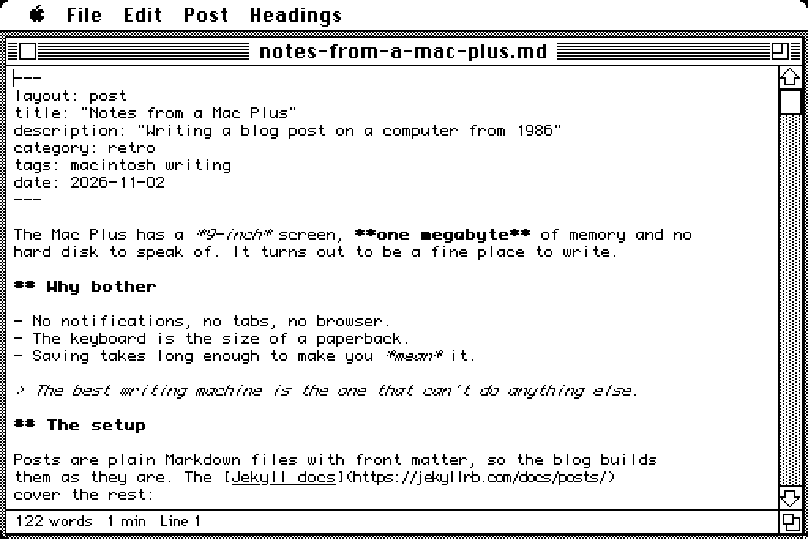
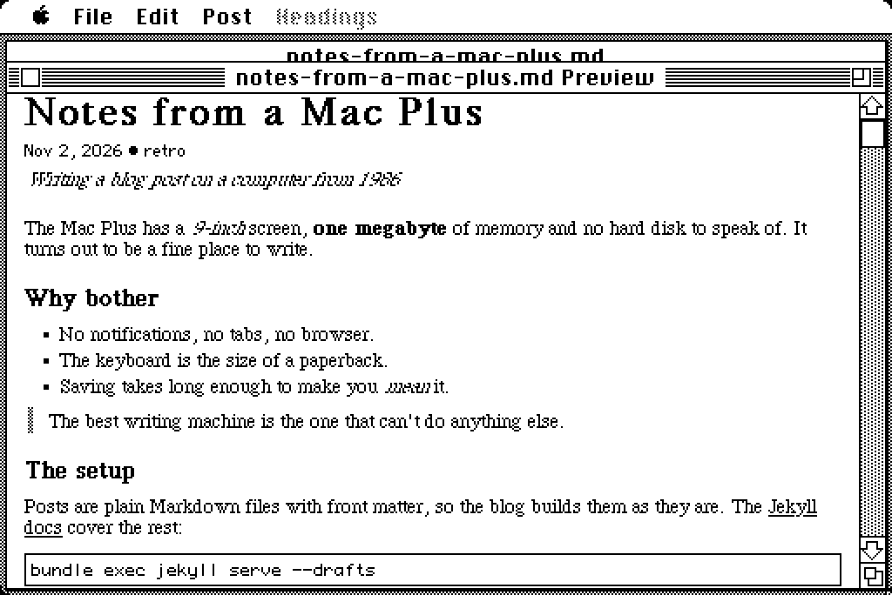
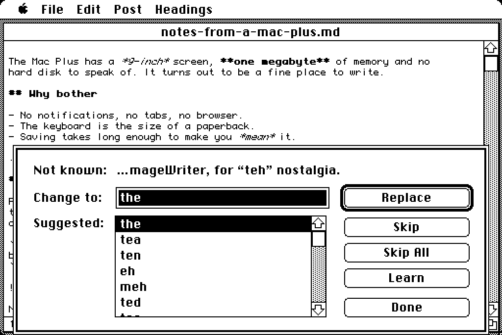

# Topica

A Markdown writer for blogs, for the classic Macintosh: the Macintosh
512Ke and the Mac Plus on System 6, up to a 68k Mac in color on System 7.
It writes posts for static site generators such as Jekyll and Hugo:
front matter, Markdown, and UTF-8 files a blog can use as they are.

The name is Aristotle's *Topics*, his book on finding things to say: the
*topoi*, the "places" a writer goes for material.

> Topica is nearly 1.0. [docs/LIMITS.md](docs/LIMITS.md) says what it
> doesn't do, and [TODO.md](TODO.md) what's coming.


<table>
<tr>
<td width="33%" valign="top"></td>
<td width="33%" valign="top"></td>
<td width="33%" valign="top"></td>
</tr>
<tr>
<td valign="top">Formatting as you type</td>
<td valign="top">The preview</td>
<td valign="top">Check Spelling</td>
</tr>
</table>

*Above: System 7.6.1 in 256 colors in Basilisk II. Below it: System 6.0.8
on a Mac Plus in Snow, pixel for pixel.*

## Download

Get the [latest release](https://github.com/ecliptik/topica/releases/latest).
There are three builds, each as a floppy image (`.dsk`), a StuffIt archive
(`.sit`) and BinHex (`.hqx`):

| File | For |
|---|---|
| `Topica-full-…` | the Mac Plus and later, on System 6.0.8 to 7.6.1 |
| `Topica-lite-…` | 512K Macs (the Macintosh 512Ke) |
| `Topica-lite-talkip-…` | 512K Macs that publish over LocalTalk, through a MacIP gateway |

The `.dsk` is an 800K disk image for an emulator or a floppy emulator, or
to write to a real floppy. The `.sit` and
`.hqx` hold the same files for a Mac that's already on a network.

## Getting started

1. Copy **Topica** and **Topica Dictionary** to the same folder on your
   Mac. The dictionary is for Check Spelling; Topica runs without it.
2. Open Topica, then File › New Post (⌘N), or File › Open a Markdown
   file. Posts from a file server open too, typed or not.
3. Post › Post Info (⌘E) fills in the front matter; File › Save suggests a
   `YYYY-MM-DD-title.md` name.
4. To publish from the Mac, set up the bridge on a computer on your
   network ([bridge/README.md](bridge/README.md)) and choose Post ›
   Publish.

**About Topica**, on the disk, is the short guide.

## What it does

- **Edits posts** in windows that fit a 512×342 screen, in Monaco 9 with
  the text wrapped to the window. Several windows at once.
- **Shows the formatting as you write:** headings and **strong** text in
  bold, *emphasis* in italics, `code` in Monaco, link text underlined, in
  color on a color screen. Post › Hide Formatting turns it off; it starts
  off on a 68000, where it slows down long posts.
- **Themes** (Post › Theme): Light and Dark on any Mac, and on a color
  Mac Solarized, TokyoNight, Amber CRT, System 7, Dracula, Nord, Green
  Screen, Classic, Monokai and Gruvbox, for the post and the preview.
  Printing stays black on white.
- **The Headings menu** lists the post's headings; choose one to go there.
- **Preview** (⌘R) shows the post laid out like its web page: the title and
  date from the front matter, headings, lists, quotes, code, tables,
  pictures, and the links listed at the end. On a screen with room for both
  it's a pane beside the post, in the same window (drag the line between
  them); on a 512×342 screen, a window of its own. It follows the post as
  you write; double-click to go to that place in the post.
- **Pictures in the preview** come from the blog's files when they're on
  the Mac: an image's address is looked for from the post's folder, and
  from the folders above it for one from the site's top (`/assets/...`).
  QuickTime 2.5 or later draws JPEG, GIF, PNG and the rest; any Mac draws
  PICT files. A picture that isn't there shows as a framed box.
- **Print** (⌘P) prints that layout, and **Export HTML** writes the post
  as a web page of its own.
- **Check Spelling** (⌘;) with suggestions, Skip All and Learn, leaving
  code, addresses, Liquid and HTML alone. The dictionary is about 89,000
  American words from [SCOWL](http://wordlist.aspell.net/). On System 7,
  **Check Spelling With** hands the post to a Word Services checker such
  as Excalibur instead; its corrections undo as one step.
- **vi keys**, if you want them (Preferences): normal, insert and visual
  modes, counts, operators and text objects, undo, `.` to repeat,
  registers, marks, and `:w` `:q` `:wq`, with a block cursor in normal mode.
- **Straight quotes where they matter:** Option-[ types curly quotes in
  prose and straight ones in code and front matter.
- **Publish** sends the post to a small bridge on your LAN
  ([`bridge/`](bridge/README.md)), which commits it to the blog's drafts
  branch, for you to merge when you're ready. Over MacTCP, or over
  LocalTalk on a 512Ke (the `--talkip` build). The bridge can be an
  address or a name. It goes on in the background while you write: the
  post's status line says how far it's got, and Post › Stop Publishing
  ends it.
- **Undo and Redo** many steps (⌘Z, ⌘⇧Z): Typing, Delete, Cut, Paste,
  Clear, Post Info and Insert Image each undo as one step.
- **Post Info** (⌘E) edits the front matter's title, description,
  category, tags, layout and date in a dialog, and rewrites only those
  lines. Keys it doesn't know, comments and list styles stay as they were;
  values that need YAML quotes get them.
- **New Post** (⌘N) starts from a front-matter template, or your own: a
  text file called "Topica Template" beside Topica, where `{{date}}`
  becomes today's date. Save suggests a `YYYY-MM-DD-title.md` name that
  fits the Mac's 31 characters.
- **Insert Image** writes a Markdown image placeholder,
  ``, and **Insert
  Link** (⌘K) a link around the selection.
- **UTF-8 in, UTF-8 out.** Posts are UTF-8 with LF line ends on disk and
  Mac Roman in the editor. Characters Mac Roman doesn't have (`ａ`, `→`,
  emoji) show as `&#xFF41;` while you edit and are written back as the same
  UTF-8, byte for byte. A file that isn't UTF-8 opens as Mac Roman.
- **Local disks and AppleShare.** Saving writes a temporary file beside
  the post first, then puts it in place, so a full disk or a dropped
  network leaves the old post whole. Open shows text files and files named
  `.md`, `.markdown` or `.txt` whatever their type, since a file server
  may not know a `.md` file is text.
- **Find and Replace** (⌘F, ⌘G, ⌘=), with whole words and matching case.
- **Preferences:** font and size, Jekyll or Hugo, UTF-8 or Mac Roman, the
  image folder and autosave, in a text file you can read.
- **Crash recovery:** unsaved posts are copied aside when you pause, and
  come back after a crash.
- **The status line** shows the words, the reading time and the line.
- **Mac manners:** the 1992 Human Interface Guidelines' menus and alerts
  (Save, Don't Save, Cancel), ⌘. cancels dialogs, the Clipboard is shared
  with desk accessories, documents open from the Finder (System 7's Apple
  events included), and its own icons.

## Requirements

| Build | For | Memory |
|---|---|---|
| Topica Lite | 512K Macs (the Macintosh 512Ke) | 2 windows, 8 KB of undo per window |
| Topica | the Mac Plus and later, System 6.0.8 to 7.6.1 | 6 windows, 32 KB of undo per window |

Both run on a 68000. Publishing needs MacTCP, or for the talkip build
LocalTalk and a MacIP gateway, and the bridge on your network. Topica
opens posts of up to 32,000 characters, about 5,000 words (it uses the
Toolbox's TextEdit); [docs/LIMITS.md](docs/LIMITS.md) has the rest of the
limits.

## Building

Topica is C, cross-compiled with [Retro68](https://github.com/autc04/Retro68).

```sh
scripts/build.sh                 # Topica: build/full/
scripts/build.sh --preset lite   # Topica Lite: build/lite/
scripts/build.sh --preset lite --talkip   # Lite with TCP/IP over LocalTalk: build/lite-talkip/
make -C tests test               # the portable core's tests, on the host
python3 -m unittest discover -s bridge    # the bridge's tests
```

Each build makes a MacBinary `.bin`, an 800K `.dsk` floppy image, a
BinHex `.hqx`, and a StuffIt `.sit` of the floppy's files when a `sit`
archiver is at hand (`EMU`). The first build downloads SCOWL's word lists (and checks
them) to make the spelling dictionary, Topica Dictionary, which goes on the
floppy beside Topica with SCOWL's copyright notice. `RETRO68` points at the toolchain. `--talkip` needs
[talkip](https://github.com/ecliptik/talkip) cloned next to Topica (or
`TALKIP_DIR`). [docs/TESTING.md](docs/TESTING.md)
covers the emulators.

`scripts/release.sh` builds all three from the version's tag (talkip at a
released version) and publishes them with the version's CHANGELOG section;
`--dry-run` builds and shows what it would publish.

## Layout

- `core/`: portable C89 with no Toolbox calls: UTF-8 and Mac Roman, front
  matter, undo, post names and word counts, a Markdown scanner for styling
  and headings, the post as page blocks, line breaking, HTML, vi, and the
  dictionary and spelling, and Publish's request and reply. Tested on the
  host.
- `app/`: the Macintosh application. Every edit goes through one call
  (`EdReplace` in `app/editor.h`), with the Toolbox's TextEdit behind it.
- `resources/`: menus, dialogs, alerts and icons (Rez).
- `bridge/`: topica-bridge, the server Publish sends posts to (Python).
- `scripts/`, `tests/`, `tools/`: building, emulators, tests, icons, the
  dictionary maker.

## Licence

ISC. See [LICENSE](LICENSE). The dictionary is made from SCOWL, Copyright
2000-2018 Kevin Atkinson and others, under its own permissive licence.
